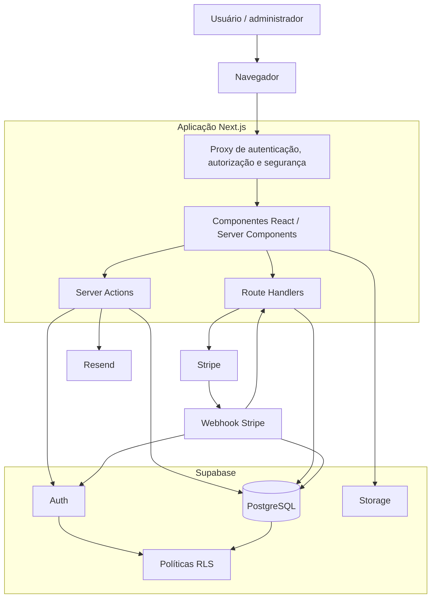
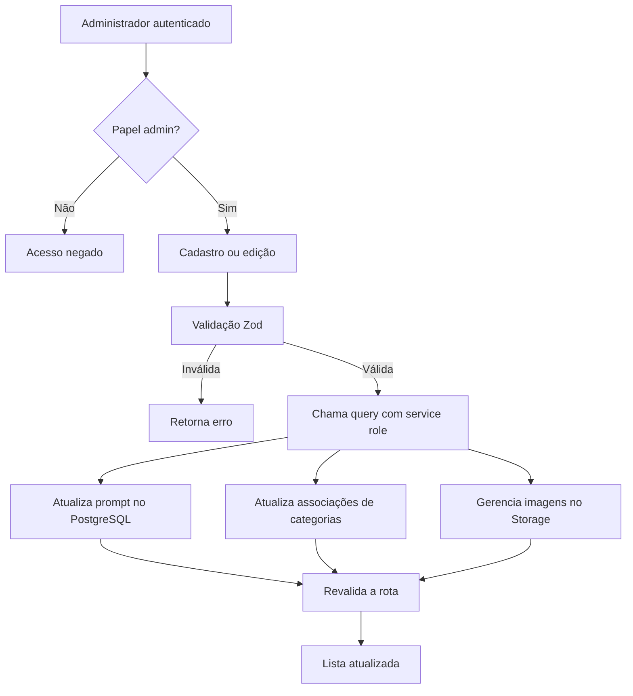
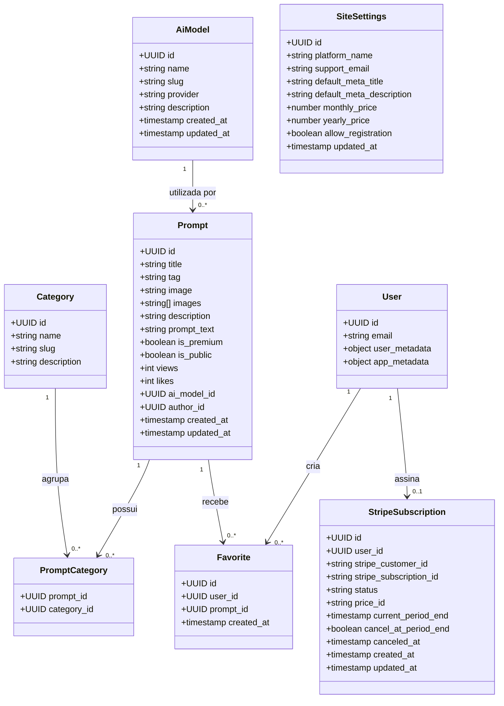
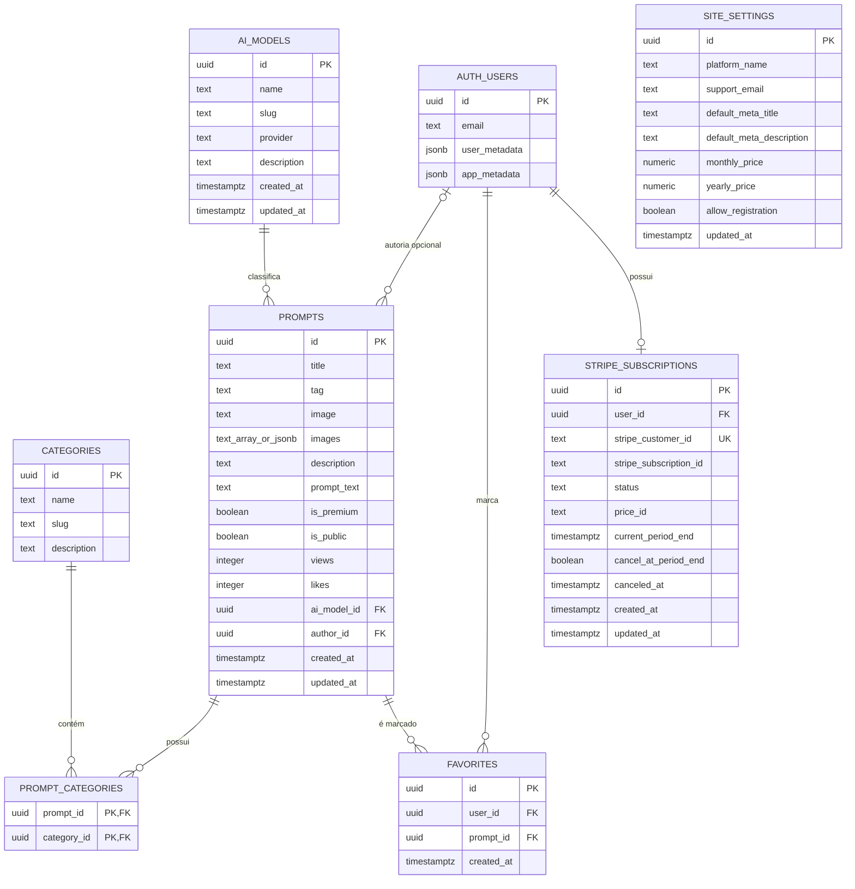

<p align="center">
  
</p>

<h1 align="center">O Rei do Prompt</h1>

<p align="center">
  Plataforma completa para descoberta, organização e monetização de prompts profissionais para Inteligência Artificial.
</p>

<p align="center">
  <a href="#funcionalidades">Funcionalidades</a> •
  <a href="#tecnologias">Tecnologias</a> •
  <a href="#arquitetura">Arquitetura</a> •
  <a href="#como-executar">Como executar</a> •
  <a href="#documentação">Documentação</a>
</p>

---

## Sobre o projeto

**O Rei do Prompt** é uma aplicação web voltada para creators, designers e profissionais que utilizam modelos de geração de imagens e texto. A plataforma reúne prompts testados em uma biblioteca pesquisável, permite gerenciamento de favoritos e oferece planos gratuitos e premium.

A aplicação combina Next.js com Supabase para autenticação, banco de dados e armazenamento, além de Stripe para checkout de assinaturas e Resend para mensagens de contato.

---

## Funcionalidades

### Área pública

- Catálogo de prompts com busca, filtros e ordenação
- Navegação por categorias e modelos de IA
- Galeria de imagens e detalhes de cada prompt
- Contador de visualizações e curtidas
- Identificação de prompts públicos e premium
- Páginas institucionais, FAQ, suporte, planos e tutorial
- SEO com metadados e Open Graph por prompt
- Sitemap, robots e configuração de segurança HTTP

### Área do usuário

- Cadastro, login e recuperação de senha
- Autenticação gerenciada pelo Supabase Auth
- Favoritos vinculados ao usuário
- Visualização do plano e da assinatura
- Fluxo de checkout e portal de cobrança Stripe
- Controle de acesso por plano (`free`, `pro` e `ultra`)

### Área administrativa

- Painel protegido por papel `admin`
- Gerenciamento de prompts, categorias e modelos de IA
- Upload e limpeza de imagens no Storage
- Gerenciamento de usuários, banimento e acesso Pro
- Configurações gerais da plataforma
- Relatórios e métricas visuais no dashboard

### Integrações

- Stripe Checkout e Customer Portal
- Webhooks Stripe para sincronização de assinaturas
- Supabase Row Level Security (RLS)
- Resend para o formulário de contato
- Limitação de tentativas em rotas de autenticação e contato

---

## Tecnologias

| Camada | Tecnologia |
|---|---|
| Framework | Next.js 16, React 19 |
| Linguagem | TypeScript |
| Interface | Tailwind CSS 3, Radix UI, Framer Motion |
| Backend | Next.js Server Actions e Route Handlers |
| Banco e autenticação | Supabase PostgreSQL e Supabase Auth |
| Storage | Supabase Storage |
| Pagamentos | Stripe SDK e Stripe Checkout |
| E-mail | Resend |
| Validação | Zod |
| Deploy recomendado | Vercel |

---

## Arquitetura

### Visão geral



### Fluxo de navegação e acesso

```mermaid
sequenceDiagram
    actor Visitante
    participant App as Next.js
    participant Proxy
    participant Supabase
    participant Postgres

    Visitante->>App: Acessa uma rota
    App->>Proxy: Processa a requisição
    Proxy->>Supabase: Valida sessão
    Supabase-->>Proxy: Usuário e metadados

    alt Rota privada sem sessão
        Proxy-->>Visitante: Redireciona para /auth/login
    else Rota administrativa
        Proxy->>Proxy: Verifica papel admin
        alt Usuário não administrador
            Proxy-->>Visitante: Redireciona para /conta
        else Usuário administrador
            Proxy->>Postgres: Executa consulta autorizada
            Postgres-->>Proxy: Dados
            Proxy-->>Visitante: Renderiza painel
        end
    else Rota pública
        Proxy->>Postgres: Consulta conteúdo público
        Postgres-->>Visitante: Renderiza página
    end
```



### Fluxo de assinatura Stripe

```mermaid
flowchart LR
    A["Usuário autenticado"] --> B["Seleciona plano"]
    B --> C["POST /api/stripe/checkout"]
    C --> D{"Cliente Stripe existe?"}
    D -->|Não| E["Cria customer no Stripe"]
    E --> F["Registra stripe_customer_id"]
    D -->|Sim| G["Recupera cliente existente"]
    F --> H["Cria Checkout Session"]
    G --> H
    H --> I["Redirecionamento ao Stripe"]
    I --> J["Pagamento"]
    J --> K["Webhook Stripe"]
    K --> L["Valida assinatura"]
    L --> M["Atualiza stripe_subscriptions"]
    M --> N["Atualiza metadados no Supabase Auth"]
    N --> O["Libera plano Pro ou Ultra"]
```



### Fluxo de gerenciamento de prompts



---

## Diagrama de classe

O diagrama representa os principais tipos de domínio usados pela aplicação. Entidades persistidas são refletidas nas tabelas do PostgreSQL; o usuário é fornecido pelo Supabase Auth.



---

## Diagrama lógico de dados



### Cardinalidades e integridade

- `prompts.ai_model_id` referencia `ai_models.id`.
- `prompt_categories` implementa o relacionamento muitos para muitos entre prompts e categorias.
- `favorites.user_id` referencia `auth.users.id` e `favorites.prompt_id` referencia `prompts.id`.
- `favorites` possui unicidade lógica por combinação de usuário e prompt.
- `stripe_subscriptions.user_id` possui relação única com um usuário.
- `stripe_subscriptions.stripe_customer_id` possui valor único.
- Exclusão de usuário remove sua assinatura e seus favoritos por cascata, conforme as políticas configuradas no Supabase.
- A tabela `site_settings` concentra a configuração global exibida pela aplicação.

---

## Segurança

A aplicação aplica segurança em múltiplas camadas:

- Row Level Security habilitado nas tabelas do domínio público e administrativo.
- Prompts públicos acessíveis por visitantes; alterações restritas a administradores ou à service role.
- Categorias e modelos permitidos para consulta pública.
- Favoritos restritos ao próprio usuário.
- Configurações públicas disponíveis para leitura e protegidas contra alteração indevida.
- Assinaturas Stripe somente visíveis pelo usuário proprietário e atualizáveis pela service role.
- Verificação do papel administrativo em `proxy.ts` e em Server Actions.
- Headers HTTP de segurança, incluindo CSP, HSTS, `X-Frame-Options` e `Referrer-Policy`.
- Validação de entrada com Zod.
- Honeypot e limite de taxa no envio de contato.
- Limitação de tentativas nas rotas de autenticação.
- Validação da assinatura dos webhooks do Stripe.

> Nunca exponha `SUPABASE_SERVICE_ROLE_KEY`, `STRIPE_SECRET_KEY`, `STRIPE_WEBHOOK_SECRET` ou `RESEND_API_KEY` em variáveis `NEXT_PUBLIC_*`.

---

## Estrutura do projeto

```text
app/
├── admin/                 # Dashboard e operações administrativas
├── api/stripe/            # Checkout, portal e webhooks
├── auth/                  # Login, cadastro e recuperação
├── prompt/[id]/           # Detalhe do prompt
├── prompts/               # Listagem pública
└── planos/                # Planos e assinatura

components/
├── admin/                 # Componentes do painel administrativo
├── auth/                  # Componentes de autenticação
├── prompt-detail/         # Galeria e texto do prompt
└── ui/                    # Componentes reutilizáveis

lib/
├── supabase/              # Clientes, consultas e autorização
├── stripe.ts              # Configuração do Stripe
└── validations.ts         # Schemas Zod

supabase/
└── migrations/            # RLS e tabela de assinaturas

docs/
└── stripe/                # Documentação específica de pagamentos

public/
└── ...                    # Imagens e recursos estáticos
```

---

## Como executar

### Pré-requisitos

- Node.js 20 ou superior
- Conta no Supabase
- Conta no Stripe para os recursos de assinatura
- Conta no Resend para o envio de contato

### Instalação

```bash
git clone https://github.com/carlosnani/reidoprompt.git
cd reidoprompt
npm install
```

### Configuração de ambiente

Crie um arquivo `.env.local` na raiz:

```dotenv
# Aplicação
NEXT_PUBLIC_APP_URL=http://localhost:3000
NEXT_PUBLIC_SITE_URL=http://localhost:3000

# Supabase
NEXT_PUBLIC_SUPABASE_URL=https://seu-projeto.supabase.co
NEXT_PUBLIC_SUPABASE_PUBLISHABLE_KEY=sua_chave_publicavel
SUPABASE_SERVICE_ROLE_KEY=sua_service_role_key
ADMIN_EMAIL=admin@seudominio.com

# Stripe
NEXT_PUBLIC_STRIPE_PUBLISHABLE_KEY=pk_test_...
STRIPE_SECRET_KEY=sk_test_...
STRIPE_WEBHOOK_SECRET=whsec_...
STRIPE_PRICE_ID_MONTHLY=price_...
STRIPE_PRICE_ID_YEARLY=price_...

# Resend
RESEND_API_KEY=re_...
```

Se estiver em ambiente já configurado com a chave anônima legada, use também o padrão de chave suportado pelo projeto:

```dotenv
NEXT_PUBLIC_SUPABASE_ANON_KEY=sua_chave_anonima
NEXT_PUBLIC_SUPABASE_PUBLISHABLE_KEY=sua_chave_publicavel
```

> Consulte o projeto no painel do Supabase antes de aplicar as migrations. Não registre chaves privadas no Git.

### Configuração do banco

Execute as migrations disponíveis em `supabase/migrations` no SQL Editor do Supabase:

1. `configure_rls_policies.sql`
2. `add_stripe_subscriptions.sql`

Confirme que as tabelas necessárias já existem no esquema público:

- `prompts`
- `categories`
- `ai_models`
- `prompt_categories`
- `favorites`
- `site_settings`
- `stripe_subscriptions`

### Executando localmente

```bash
npm run dev
```

A aplicação estará disponível em `http://localhost:3000`.

### Scripts

```bash
npm run dev    # Servidor de desenvolvimento
npm run build  # Build de produção
npm run start  # Servidor após o build
npm run lint   # Verificação ESLint
```

---

## Configuração Stripe

O guia detalhado está disponível em [docs/stripe/STRIPE_SETUP.md](./docs/stripe/STRIPE_SETUP.md).

Resumo:

1. Crie os preços mensal e anual no Stripe.
2. Configure as variáveis de preço no ambiente.
3. Configure o webhook para `/api/stripe/webhooks`.
4. Assine os eventos de assinatura e faturamento necessários.
5. Informe o signing secret em `STRIPE_WEBHOOK_SECRET`.
6. Teste o fluxo com os dados de teste fornecidos pelo Stripe.

---

## Deploy

### Vercel

1. Importar o repositório na Vercel.
2. Selecionar Next.js como framework.
3. Adicionar todas as variáveis de ambiente.
4. Utilizar a URL de produção em `NEXT_PUBLIC_APP_URL` e `NEXT_PUBLIC_SITE_URL`.
5. Configurar o webhook Stripe com a URL de produção.
6. Executar o deploy.

Antes de publicar:

- Execute `npm run lint`
- Execute `npm run build`
- Valide login, cadastro e recuperação de senha
- Valide permissões de administrador
- Valide Stripe em ambiente de teste
- Confirme as políticas RLS no Supabase

---

## Documentação

- [Configuração completa do Stripe](./docs/stripe/STRIPE_SETUP.md)
- [Visão geral da integração Stripe](./docs/stripe/STRIPE_README.md)
- [Índice da documentação Stripe](./docs/stripe/INDICE.md)
- [Checklist de implementação](./docs/stripe/CHECKLIST_IMPLEMENTACAO.md)
- [Referência da API](./docs/stripe/API_REFERENCE.md)

---

<p align="center">
  Desenvolvido para ajudar criadores a dominar a geração de imagens com IA.
</p>
